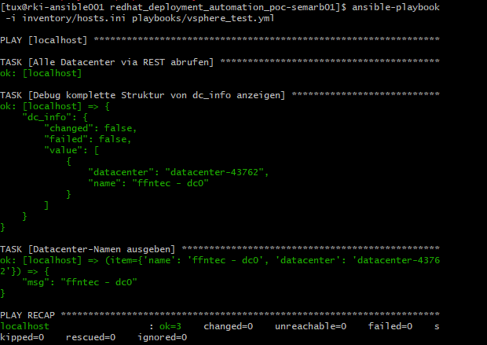

<h3> Project Workbook </h3>

<span style="color:#FF5800; font-size: 200%; font-weight: bold">Red Hat Automation in first365 POC</span>

Erstellt für

<span style="color: #FF5800; font-size: 150%; font-weight: bold"> first frame networkers ag</span>

| Datum | 04.07.2025 |
| ---- | ---- |
|Version| 1.0 |
|Status| Produktiv |
|Klassifizierung| Vertraulich |
|||

von: Robin Kiefer

Reviews

| Datum | Reviewer | Position | Version bestätigt |
| --- | --- | --- | --- |
| 04.07.2025 |  Robin Kiefer   | PL  |     |

## **Inhaltsverzeichnis**

- [**Einleitung**](#einleitung)
  - [**Projektziel**](#projektziel)
  - [**Dokumentzweck**](#dokumentzweck)
  - [**Referenzen**](#referenzen)
- [**Anforderungszusammenfassung**](#anforderungszusammenfassung)
  - [**Businessanforderungen**](#businessanforderungen)
  - [**Anwenderanforderungen**](#anwenderanforderungen)
  - [**Betriebliche Anforderungen**](#betriebliche-anforderungen)
  - [**Technische Anforderungen**](#technische-anforderungen)
  - [**Abgrenzung**](#abgrenzung)
- [**Annahmen und Abhängigkeiten**](#annahmen-und-abhängigkeiten)
  - [**Annahmen, Einschränkungen, Abhängigkeiten**](#annahmen-einschränkungen-abhängigkeiten)
    - [Annahmen](#annahmen)
    - [Einschränkungen](#einschränkungen)
    - [Abhängigkeiten](#abhängigkeiten)
- [**Lösungsdesign**](#lösungsdesign)
  - [**Konzeptionelles Lösungsdesign**](#konzeptionelles-lösungsdesign)
  - [**Physisches Lösungsdesigne**](#physisches-lösungsdesigne)
    - [Inventar](#inventar)
  - [**Logisches Lösungsdesign**](#logisches-lösungsdesign)
    - [**Ansible Datenablagen**](#ansible-datenablagen)
    - [**Repository**](#repository)
    - [Templates](#templates)
    - [APIs](#apis)
- [**Sicherheitsstrategie**](#sicherheitsstrategie)
  - [Sicherheitsstrategie](#sicherheitsstrategie-1)
    - [Hauptziele für eine sichere Umgebung](#hauptziele-für-eine-sichere-umgebung)
    - [Mögliche Kompromisse für Usability und Performance](#mögliche-kompromisse-für-usability-und-performance)
    - [Eingesetzte Sicherheitsmechanismen](#eingesetzte-sicherheitsmechanismen)
- [**Installation / Setup**](#installation--setup)
  - [Ansibel](#ansibel)
    - [Basis Konfiguration](#basis-konfiguration)
  - [Playbooks \& Skripts](#playbooks--skripts)
    - [deploy\_rehl.yml](#deploy_rehlyml)
    - [create\_user\_pw.sh](#create_user_pwsh)
    - [def\_rehl\_compose.yml.j2](#def_rehl_composeymlj2)
    - [def\_cdrom.yml.j2](#def_cdromymlj2)
    - [def\_rehl\_disk.yml.j2](#def_rehl_diskymlj2)
    - [def\_general\_nic.yml.j2](#def_general_nicymlj2)
    - [def\_rehl\_vm.yml.j2](#def_rehl_vmymlj2)
    - [check\_image\_status.sh](#check_image_statussh)
    - [def\_rehl\_firstboot.sh.j2](#def_rehl_firstbootshj2)


# **Einleitung**

Ich besuche zurzeit die HF im Bereich Cloud-Native Engineering.
Infolgedessen konnte ich bereits viel wissen im Bereich Cloud-Init und Linux erarbeiten. Als teil meiner weiterführenden Schule wird nach den Osterferien die erste Semesterarbeit beginnen. Dies hat mich dazu bewegt in unserem Unternehmen nach Chancen zu suchen das gehlernte wissen für unseren Benefit anzuwenden. Nach Rücksprache mit Michael Hediger und Thomas Koller wie auch Marco Schaub habe ich einen Internen Projektantrag für die Vereinfachung und Professionalisierung unserer Red Hat Linux Deployments erarbeitet. 

In meiner Ausbildung beschäftigen wir uns Generell mit Cloud Themen. Diese sind auf jeden Fall anwendbar auf unsere eigene Public Cloud first365. Für uns im Rahmen von unseren neuen Unternehmenszielen bin ich der Meinung, dass eine Ausweitung der Automatisierung im Bereich von Deployments ins Thema Empower Customers mit dem Fokus auf Effizienz und Standardisierung entspricht. Dieses Projekt soll nicht eine abschliessende Verbesserung, sondern ein Sprungbrett für Ausbau und Ausweitung der IAC-Methode dienen, mit welcher wir Standardisierung und Effizienz ausbauen und Prozesse vereinfachen können.

## **Projektziel**

Aktuell erfordert das manuelle Deployment von Red Hat Linux-Systemen einen beträchtlichen Zeitaufwand, insbesondere durch die individuelle Konfiguration jeder Maschine. Die vorgeschlagene Lösung nutzt IaC, um Deployments zu vereinfachen und zu automatisieren. Durch diesen Ansatz wird:

- Zeit eingespart: Manuelle Setups dauern etwa 60+ Minuten, die Automatisierung reduziert dies auf ca. 15 Minuten.
- Konsistenz gewährleistet: Alle Deployments folgen einer standardisierten Konfiguration.
- Skalierbarkeit verbessert: Die Lösung kann über first365 hinaus erweitert und für andere Umgebungen eingesetzt werden.

**Zielzustand**
- ISOs befinden sich in der Content Library im vCenter
- Erstellung der VM (Automatisiert via Code)
- Registrierung in Red Hat Portal (Automatisiert via Code)
- **Optional:** Monitoring in PRTG (Automatisiert via Code)

**Wichtige Aspekte der Umsetzung**
- IaC-Technologie: Nutzung von Terraform oder Ansible, um die Red Hat-Deployments zu automatisieren.
- Integration mit VMware: Sicherstellen, dass die erstellten Maschinen nahtlos in die bestehende VMware-Umgebung eingegliedert werden können.
- Sicherheitsanforderungen:
- Kein Deployment-Code soll auf den Zielmaschinen verbleiben.
- Sichergestellter Zugriff auf GitTea für Codeverwaltung.
- Vermeidung von unverschlüsselten Übertragungen von Code oder Passwörtern.
- Erweiterungsmöglichkeiten: Die Lösung kann für verschiedene Kundenumgebungen angepasst und weiter ausgebaut werden.


## **Dokumentzweck**

Das Dokument dient dazu, die Projektziele klar zu definieren und die verschiedenen Phasen der Installation und des Setups sowie die anschliessende Deinstallation und Einführung zu strukturieren. Zudem werden Referenzen zu relevanten Dokumenten angeführt, um eine umfassende Übersicht über die erforderlichen Schritte und Anforderungen zu bieten. Weiter werden Konzeptionelle Definitionen, welche im Rahmen des Projektes festgelegt werden dokumentiert.

## **Referenzen**

Die folgenden Dokumente werden mitreferenziert:

- [*Projektziele und Umfang*](Projektziele%20und%20Umfang%20Redhat%20Automation%20in%20first365%20POC.md), Projektziele und Umfang Red Hat Automation in first365 POC, Version 1.0, Datum 26.05.2025
- [*Interner Projektantrag*](Interner%20Projektantrag.md), Interner Projektantrag, Version 1.0, Datum 09.04.2025
- [*Externer Projektantrag*](ITCNE25_Semesterarbeit%201%20Projektantrag%20Robin%20Kiefer.md), ITCNE25_Semesterarbeit 1 Projektantrag Robin Kiefer, Version 1.0, Datum 10.05.2025
- [*Referenzkonfiguration RedhatLinux*](./content/(V6)%20Basic%20Configuration%20for%20RHEL%20&%20Rocky%209.x%20(v.2024).pdf), Basic Configuration for RHEL & Rocky 9.x (v.2024), 6, 19.02.2025

# **Anforderungszusammenfassung**

Aus Dokument "Projektziele und Umfang". Diese haben sich nach der Offertbesprechung ggf. angepasst.

## **Businessanforderungen**
Die nachfolgende Tabelle definiert die wichtigsten Anforderungen an das Design und die Deployment Strategie der Lösung aus Sicht des Business:

| Nr.  | Anforderung                       | Beschreibung                                                                 |
|------|-----------------------------------|-------------------------------------------------------------------------------|
| B01  | Automatisierung der VM-Erstellung | Die Erstellung von VMs soll automatisiert werden, um Zeit zu sparen und Konsistenz zu gewährleisten. |
| B02  | Standardisierung der Konfiguration | Alle Deployments sollen einer standardisierten Konfiguration folgen, um Fehler zu minimieren und die Wartung zu erleichtern. |
| B03  | Integration mit VMware            | Die automatisierten Deployments müssen nahtlos in die bestehende VMware-Umgebung integriert werden. |

## **Anwenderanforderungen**

| Nr.  | Anforderung          | Beschreibung                                                                 |
|------|----------------------|-------------------------------------------------------------------------------|
| U01  | Benutzerfreundlichkeit | Die Lösung muss einfach zu bedienen sein, damit das Datacenter Team und das Engineering-Team sie problemlos nutzen können. |
| U02  | Dokumentation        | Eine umfassende Dokumentation der automatisierten Prozesse und Konfigurationen muss bereitgestellt werden. |

## **Betriebliche Anforderungen**
| Nr.  | Anforderung          | Beschreibung                                                                 |
|------|----------------------|-------------------------------------------------------------------------------|
| O01  | Effizienzsteigerung  | Die Automatisierung soll die Effizienz steigern und die Zeit für manuelle Setups von 60 Minuten auf 15 Minuten reduzieren. |
| O02  | Skalierbarkeit       | Die Lösung muss skalierbar sein, um zukünftige Erweiterungen und Anpassungen zu ermöglichen. |

## **Technische Anforderungen**

| Nr.  | Anforderung          | Beschreibung                                                                 |
|------|----------------------|-------------------------------------------------------------------------------|
| T01  | Sicherheit           | Es darf kein Deployment-Code auf den Zielmaschinen verbleiben, und alle Übertragungen müssen verschlüsselt sein. |
| T02  | Zugriffskontrolle    | Der Zugriff auf Konfigurationsdateien muss gesichert und kontrolliert werden. |
| T03  | Kompatibilität       | Die Lösung muss mit first365 und VMware kompatibel sein, ohne grössere Anpassungen zu erfordern. |


## **Abgrenzung**

- Die Automatisierung vom Monitoring ist ein Optionales Ziel
- Es wird keine GO-Live geben, da es sich um ein POC handelt
- Es werden keine Referenzkonfiguration erstellt nur verwendet um diese abzubilden
- Es wird keine anleitung für die Verwendung ausser das Projectworkbook geben

…

# **Annahmen und Abhängigkeiten**

Aus Dokument "Projektziele und Umfang". Diese haben sich nach der Offertbesprechung ggf. angepasst.

## **Annahmen, Einschränkungen, Abhängigkeiten**
### Annahmen
Annahmen werden von der frist frame getroffen, wenn eine Ausgangslage unklar oder nicht beschrieben ist. Die Annahmen müssen vom Kunden verifiziert werden. Sollten Annahmen nicht korrekt sein, so sind diese zu besprechen und anzupassen.

|**Annahme**|**Beschreibung** |
| :- | :- |
|Netzwerk Kapazität|Annahme, dass die Netzwerk Kapazität und Verfügbarkeit gut ist|
|Netzwerk Konfiguration|Annahme, dass die Netzwerk Dienste (DNS, ADDS) fehlerlos zur Verfügung stehen|
|Active Directory|Annahme, dass zum Start der Installation der Active Directory Domain Service (ADDS) gut gewartet ist und fehlerfrei funktioniert|
|Compliance|Annahme, dass die Umgebung des Kunden in einem gepatchten, malwarefreien Zustand ist|
|VM Infrastruktur|Die bereitgestellten virtuellen Maschine sowie deren VM Plattform ist funktionsfähig und performant|

### Einschränkungen
Derzeit keine bekannt.

### Abhängigkeiten
Nachfolgende Tabelle zeigt die wichtigsten Abhängigkeiten bei der Umsetzung des Projektes:

|**Abhängigkeit**|**Beschreibung** |
| :- | :- |
|Hardware / VM’s|Der Kunde wird die Hardware/VM’s zur Verfügung stellen|
|Permissions|Der Kunde muss einen Account mit Enterprise Admin Rechten zur Verfügung stellen|
|Administrator Schulung|Es liegt in der Verantwortung des Kunden, sicherzustellen, dass ausreichend administratives Knowhow aufgebaut wird, um die Lösung nach dem Projekt selber zu betreiben|
|||

# **Lösungsdesign**

Das Lösungsdesigne besteht aus verschiedenen Komponenten welche notwendig sind, für die Umsetzung der Lösung. Ich werde hier diese aufliesten.

| Tool | Aufgabe | Beschreibung |
|--|--|--|
| GitLab | Project & Repository Location | Enthält das Repository mit den Codes und den Dokumentationen. Wie die Projektdokumentation und die Templates |
| Red Hat Portal | Bereitstellung Lizenzen & vorbereitung von ISOs | Im Red Hat Partner Portal, sind die Maschinen zu registrieren und hier können wir ebenfalls ISOs herunterladen welche schlussendlich in das Content Library von VMware abgelegt wird. |
| Ansible | Ausführung von Playbooks & Connection zu VMware | Ermöglicht die Deployments und die Überwachung der Konfigurationen |
| VMware | Hostet die Infrastruktur (Ansible & Red Hat Maschinen) | Ist die Virtualisierungsplatform für unser first365 |
| first frame IPAM | Dokumentation von Netzwerk | Hier sind die Hosts und deren IPs Dokumentiert |
| PRTG | Monitoring | Auf PRTG haben wir das Monitoring unserer Maschinen |

Auf all diese Komponenten, gilt es den Zugriff zu erhalten und die Konfiguration vorzunehmen. Das ganze wird in den nächsten Abschnitten erklärt.


## **Konzeptionelles Lösungsdesign**


Im Bild oben, sehen wir die Konzeptionelle Lösung. Hier ist beschrieben, wie eine Maschine via Ansible Playbooks in diesem POC erstellt wird. Auf der rechten Seite, sehen wir die Portale welche wir via API ansprechen müssen.
Der Prozess soll unter verwendung von Templates welche via einem Zentralen Playbook abgerufen werden Automatisiert erledigt werden.

## **Physisches Lösungsdesigne**


Hier sind die Pysischen Elemente aufgelistet welche für die Umsetzung des POCs benötigt werden.

### Inventar

| Type | Cluster      | HostName         | HostCPU | HostMemoryGB | HostVersion       | VMName          | VMCPU | VMMemoryGB | VMOS                               | VMIP                                          | VMTools  | VMPowerState | Datastore |
|------|--------------|------------------|---------|--------------|-------------------|------------------|-------|------------|------------------------------------|-----------------------------------------------|----------|--------------|-----------|
| Host | ffntec-cl301 | hv303.ffntec.ch  | 4       | 32           | 8.0.3             |                  |       |            |                                    |                                               |          |              |           |
| Host | ffntec-cl301 | hv302.ffntec.ch  | 4       | 32           | 8.0.3             |                  |       |            |                                    |                                               |          |              |           |
| Host | ffntec-cl301 | hv301.ffntec.ch  | 4       | 32           | 8.0.3             |                  |       |            |                                    |                                               |          |              |           |
| VM   | ffntec-cl301 | ConsoleHost      |         | 0            | 5.1.26100.1882    | rki-ansible001   | 1     | 2          | Red Hat Enterprise Linux 9 (64-bit) | 10.6.128.60, fe80::250:56ff:febb:a961         | toolsOk  | PoweredOn     |           |

## **Logisches Lösungsdesign**

Konfigurations Elemente:

### **Ansible Datenablagen**

| Location | Description |
|-|-|
| /etc/ansible/redhat_deployment_automation_poc-semarb01/ | Root pfad für Repo und Templates |


### **Repository**

Die Konfiguration des Repository ist in der Abbilung unten aufgeführt. So sollen die Strukturen für die Templates und die Ansible konfiguration aussehen.

```bash
redhat_deployment_automation_poc-semarb01/
├── ansible.cfg
├── inventory/
│   └── hosts.ini
├── playbooks/
│   └── deploy_rehl.yml
│   └── get_rehlapi_token.yml
│   └── vsphere_test.yml
├── templates/
│   ├── firstboot_script/
│   │   └── rehl_firstboot.sh.j2
│   ├── disks/
│   │   └── def_disk.yml.j2
│   ├── cdrom/
│   │   └── def_cdrom.yml.j2
│   ├── network/
│   │  └── def_nic.yml.j2
│   ├── rehl_api/
│   │  └── def_rehl_compose.yml.j2
│   ├── vm/
│   └── └── def_vm.yml.j2
|________________________
```

### Templates

Folgende Templates werden benötigt für das Projekt.

- disk Template
- cdrom Template
- nic Template
- firstboot Script
- compose Template
- vm Template


### APIs

Verwendete APIs und deren Funktionen sind in der Unteren Tabelle erklärt.

| API                         | Zweck                                                                                   |
|-----------------------------|------------------------------------------------------------------------------------------|
| **Red Hat Partner Connect API** | Registrierung und Lizenzierung der Maschinen, Installieren neuster Images in die Content Library |
| **GitLab API**              | SSH-Token-Erstellung, Repository-Zugriff (Git Clone), Ausführung von CI/CD-Pipelines    |
| **IPAM API**                | Automatisches Eintragen und Dokumentieren neuer Server in der IPAM-Datenbank            |
| **PRTG API**                | Erstellung und Konfiguration von Monitoring-Sensoren für neue Systeme                   |


# **Sicherheitsstrategie**

## Sicherheitsstrategie

Die Sicherheitsstrategie dieses Projekts stellt sicher, dass alle automatisierten Prozesse sowie der Zugriff auf Systeme und Ressourcen vertraulich, nachvollziehbar und geschützt erfolgen. Der Fokus liegt auf einer sicheren Automatisierung, die keine sensiblen Informationen kompromittiert.

### Hauptziele für eine sichere Umgebung

- Sicherstellung der Vertraulichkeit von Zugangsdaten und Tokens
- Schutz vor unautorisiertem Zugriff auf Repositories und Infrastruktur
- Minimierung von Risiken durch temporäre oder wiederverwendbare Authentifizierungsmechanismen

### Mögliche Kompromisse für Usability und Performance

- Temporäre SSH-Tokens mit Ablaufzeit erhöhen Sicherheit, erfordern aber gelegentliche Neuausstellung
- Secrets werden nicht dauerhaft auf der Zielmaschine gespeichert, was gewisse Debug-Einschränkungen bedeuten kann
- Maschinen müssen nach der Konfiguration Repositories aktiv selbstständig entfernen, was zusätzlichen Automatisierungsaufwand bedeutet

### Eingesetzte Sicherheitsmechanismen

| Massnahme                                | Beschreibung                                                                 |
|----------------------------------------|------------------------------------------------------------------------------|
| **Versteckte Variablen im Repository** | Ansible-Variablen, Secrets und Tokens werden im GitLab Repository verschlüsselt bzw. als geschützte CI-Variablen geführt |
| **Kein Verbleib von Secrets auf Systemen** | Zugangsdaten, SSH-Keys und Tokens werden nach dem Deployment automatisch entfernt |
| **SSH-Key-basierte Authentifizierung** | Zugriff auf Systeme und Repositories erfolgt ausschliesslich über SSH-Keys oder OAuth-basierte Tokens |
| **Ablaufende SSH/Git-Tokens**          | Zugriffstokens für Git-Operationen laufen automatisch ab und müssen regelmässig erneuert werden |
| **Repository Cleanup**                | Nach erfolgtem Deployment werden geklonte Repositories automatisch vom Zielsystem gelöscht |

Diese Sicherheitsstrategie folgt dem Grundsatz „Security by Default“ und berücksichtigt typische Anforderungen an Automatisierung in Enterprise-Umgebungen.

# **Installation / Setup**

Wie die Konfiguration der Bestandteile umgesetzt wird, ist in diesem Bereich aufgeführt. Alle Notwendigen Projektschritte und Konfigurationen sind hier ersichtilich.
Für die Templates 

## Ansibel

### Basis Konfiguration

**Repository**

Auf das Repository wird via SSH-Key zugegriffen durch Ansible.

```bash

# SSH-Key generieren
ssh-keygen -t rsa -b 4096 -f ~/.ssh/id_ansible

# SSH-Key dem Agent hinterlegen
ssh-add ~/.ssh/id_ansible

# Vault erstellen
ansible-vault create etc/ansible/credentials_vault.yml #leer erstellen

sudo chmod 600 etc/ansible/credentials_vault.yml

## Einträge verschlüsselt einfügen
sudo ansible-vault encrypt_string '***' --name 'gitlab_sshkey_passphrase' > etc/ansible/credentials_vault.yml

# Leerzeile anhängen
echo >> etc/ansible/credentials_vault.yml

cat ~/.ssh/id_ansible | ansible-vault encrypt_string --stdin-name 'gitlab_sshkey' >> etc/ansible/credentials_vault.yml


# Vault password.sh erstellen
echo 'vault_passwort ****' > ~/.vault_pass.txt # passwort eintragen
chmod 600 ~/.vault_pass.txt 

# Vault password in ansible.cfg hinterlegen
sudo vim ansible.cfg

## Eintragen: 
[defaults]
vault_password_file = /home/<username>/bin/.vault-pass.txt

# Git Repo in /etc/ansible klonen
## Schreibe Rechte für tux auf /etc/ansible
sudo setfacl -m u:tux:rwx /etc/ansible

## Damit neu erstellte Unterordner ebenfalls die Rechte erben
sudo setfacl -d -m u:tux:rwx /etc/ansible

## Kontrolle
getfacl /etc/ansible

## Git Clone
git clone git@gitlab.com:hf9064413/Redhat_deployment_automation_poc-semarb01.git

# Konfiguration ansible.cfg
sudo vim ansible.cfg

############
[defaults]
ask_become_pass = true # sudo rechte erteilen
vault_password_file = /home/<username>/bin/.vault-pass.txt
inventory = ./redhat_deployment_automation_poc-semarb01/inventory/hosts.ini
library = ./redhat_deployment_automation_poc-semarb01/playbooks/library # Library Pfad im ansible.cfg eintragen

# hosts.ini erstellen
[management]
rki-ansible001 ansible_host=10.6.128.60

[all:vars]
ansible_user=tux
credentials_vault=../../credentials_vault.yml
project_dir=../../redhat_deployment_automation_poc-semarb01/
playbooks_dir=../../redhat_deployment_automation_poc-semarb01/playbooks/
```

**Module Installation**

```bash
# vmware module installieren
sudo ansible-galaxy collection install community.vmware
sudo /usr/bin/python3 -m pip install aiohttp
```

**vcenter verbindung konfigurieren und testen**

**Test Playbook**
```yml
---
- hosts: localhost
  connection: local
  gather_facts: false
  collections:
    - vmware.vmware_rest

  vars_files:
    - "{{ credentials_vault }}"

  tasks:
    - name: Alle Datacenter via REST abrufen
      vmware.vmware_rest.vcenter_datacenter_info:
        vcenter_hostname:     "{{ vcenter_host }}"
        vcenter_username:     "{{ vcenter_user }}"
        vcenter_password:     "{{ vcenter_pw }}"
        vcenter_validate_certs: false
      register: dc_info

    - name: Debug komplette Struktur von dc_info anzeigen
      debug:
        var: dc_info

    - name: Datacenter-Namen ausgeben
      debug:
        msg: "{{ item.name }}"
      loop: "{{ dc_info.value }}"

```


```bash

# decrypt vault
ansible-vault decrypt etc/ansible/credentials_vault.yml

# Leerzeile anhängen
sudo echo >> etc/ansible/credentials_vault.yml

## Einträge verschlüsselt einfügen
sudo ansible-vault encrypt_string '***' --name 'vcenter_host' >> etc/ansible/credentials_vault.yml

# Leerzeile anhängen
sudo echo >> etc/ansible/credentials_vault.yml

## Einträge verschlüsselt einfügen
sudo ansible-vault encrypt_string '***' --name 'vcenter_user' >> etc/ansible/credentials_vault.yml

# Leerzeile anhängen
sudo echo >> etc/ansible/credentials_vault.yml

## Einträge verschlüsselt einfügen
sudo ansible-vault encrypt_string '***' --name 'vcenter_pw' >> etc/ansible/credentials_vault.yml

# encrypt vault
ansible-vault decrypt etc/ansible/credentials_vault.yml

# Verbindung testen:
ansible-playbook -i inventory/hosts.ini playbooks/vsphere_test.yml
```


## Playbooks & Skripts

Wir werden via Image Builder API ein ISO image erstellen und dieses in die Content-Library hochladen. 
Ebenfalls wird die gesamte VM in einem Playbook vorbereitet und Konfiguriert mit hilfe von Templates und einem Script

**Konfiguration Service-Account für Rehl Partner Portal**

- Auf https://console.redhat.com/iam/service-accounts einen Service Account erstellen
- Secrets in Ansible Vault hinzufügen

```bash
# decrypt vault
ansible-vault decrypt etc/ansible/credentials_vault.yml

# Leerzeile anhängen
sudo echo >> /etc/ansible/credentials_vault.yml

## Einträge verschlüsselt einfügen
sudo ansible-vault encrypt_string '7c944f43-7****' --name 'svc_rehl_api_client_id' >> /etc/ansible/credentials_vault.yml

# Leerzeile anhängen
sudo echo >> /etc/ansible/credentials_vault.yml

## Einträge verschlüsselt einfügen
sudo ansible-vault encrypt_string 'asfklajefj****' --name 'svc_rehl_api_client_secret' >> /etc/ansible/credentials_vault.yml

# encrypt vault
ansible-vault decrypt /etc/ansible/credentials_vault.yml

```

### deploy_rehl.yml


Dieses Ansible-Playbook automatisiert die Erstellung einer voll konfigurierten **Red Hat Enterprise Linux**-VM, inklusive:

* Image-Erstellung via **Red Hat Image Builder API**
* Cloud-Init-basierter Individualisierung (Hostname, SNMP, Zeitzone etc.)
* Upload des erzeugten ISO-Images in eine **vSphere-Umgebung**
* Provisionierung der VM mit definierter Hardware, Netzwerk und Storage

---

**Funktionsübersicht**

| Bereich                     | Beschreibung                                                               |
| --------------------------- | -------------------------------------------------------------------------- |
| **Konfig-Rendering**        | Templates für Disk, Netzwerk, CD-ROM, Firstboot-Skript und Compose-Request |
| **API-Integration**         | Authentifizierung via OpenID Connect & Tokenabruf von Red Hat SSO          |
| **Image-Build Prozess**     | POST gegen `/compose`-Endpoint, Statusabfrage über Shellscript             |
| **ISO-Transfer**            | ISO-Download über HTTPS, Upload auf vSphere-Datastore                      |
| **VM-Erstellung (vSphere)** | VM inkl. Disk, Netzwerk, ISO-CD-ROM und Custom-Konfiguration wird erstellt |

---

**Ablauf im Detail**

1. **Konfiguration vorbereiten**

   * Erstellen temporärer YAML-Dateien aus Jinja2-Templates:

     * VM-Konfiguration (`vm_config`)
     * Festplattenlayout (`disk_config`)
     * Netzwerkanbindung (`nic_config`)
     * Firstboot-Skript als Bash-Datei (base64-kodiert)
     * Compose-Request für Image Builder API

2. **Image-Build starten**

   * Passwort-Hash für Benutzer erzeugen via Bash-Skript
   * Compose-Request an Red Hat API senden
   * Warten auf Completion via externem Polling-Skript (`check_image_status.sh`)

3. **ISO verarbeiten**

   * Image-ISO herunterladen über URL der Red Hat API
   * Transfer der ISO in den vSphere-Datastore (Verzeichnisstruktur: `templates/<vm_name>/`)

4. **VM auf vSphere bereitstellen**

   * Definition von CPU, RAM, Disk, Netzwerk (inkl. VLAN) und CD-ROM
   * Optionale Dienste wie `sshd`, `snmpd.service`, `custom-first-boot` werden aktiviert
   * Hostname, Zeitzone, Locale, Benutzerpasswort und Subscription werden via Cloud-Init gesetzt


**deploy_rehl**

```yml
---
# playbooks/deploy_rehl
# ============================================
# Playbook zur Provisionierung einer RHEL-VM
# inkl. Image-Build über Red Hat API, Konfig-Rendering,
# Upload zur vSphere Umgebung und VM-Erstellung
# ============================================

- name: RHEL-VM Provisionierung inkl. Image-Build, Konfigurations-Rendering und Bereitstellung in vSphere
  hosts: localhost
  connection: local
  gather_facts: no

  # Anmeldedaten und Secrets werden aus einem verschlüsselten Vault geladen
  vars_files:
    - "{{ credentials_vault }}"

  vars:
    validate_certs: false
    vm_name: new-vm
    disk_size: "32G"
    datacenter_name: "ffntec - dc0"
    cluster_name: "ffntec-cl301"
    vm_folder: "vm/FFNTec/RKI-Nested-ESXi/VMs"
    network_name: "DSwitch01-cl301-frontend-Management Network"
    vlan_id: "0"
    vcenter_datastore: "vsanDatastore"
    snmp_string: ""
    packages:
      - "net-snmp"
    services_enabled:
      - "sshd"
      - "snmpd.service"
      - "custom-first-boot"
    ntpservers:
      - "0.ch.pool.ntp.org"
      - "1.ch.pool.ntp.org"
    status_query: "image_status.status"

  # Standardwerte für VMware-Module definieren, um Redundanz zu vermeiden
  module_defaults:
    community.vmware.vmware_guest:
      hostname: "{{ vcenter_host }}"
      username: "{{ vcenter_user }}"
      password: "{{ vcenter_pw }}"
      validate_certs: "{{ validate_certs }}"
    community.vmware.vmware_guest_disk:
      hostname: "{{ vcenter_host }}"
      username: "{{ vcenter_user }}"
      password: "{{ vcenter_pw }}"
      validate_certs: "{{ validate_certs }}"
    community.vmware.vmware_guest_network:
      hostname: "{{ vcenter_host }}"
      username: "{{ vcenter_user }}"
      password: "{{ vcenter_pw }}"
      validate_certs: "{{ validate_certs }}"
    community.vmware.vsphere_copy:
      hostname: "{{ vcenter_host }}"
      username: "{{ vcenter_user }}"
      password: "{{ vcenter_pw }}"
      validate_certs: "{{ validate_certs }}"

  tasks:
    # Generiert einen eindeutigen Zeitstempel zur Dateibenennung
    - name: Initialisierung: Timestamp zur eindeutigen Benennung generieren
      set_fact:
        compose_timestamp: "{{ lookup('pipe', 'date +%Y%m%d_%H%M%S') }}"

    # Erstellt ein lokales Arbeitsverzeichnis für temporäre Dateien der aktuellen VM
    - name: Vorbereitung: Verzeichnis für Konfigurationsdateien erstellen
      file:
        path: "{{ project_dir }}/config_store/{{ vm_name }}"
        state: directory
        mode: '0755'
      delegate_to: localhost

    # Generiert die Grundkonfiguration der VM über Jinja2-Template
    - name: VM-Konfiguration rendern
      template:
        src: "../templates/vm/def_rehl_vm.yml.j2"
        dest: "{{ project_dir }}/config_store/{{ vm_name }}/vm_config_{{ vm_name }}_{{ compose_timestamp }}.yml"

    # Lädt die VM-Konfiguration als Variablen
    - name: VM-Konfiguration laden
      include_vars:
        file: "{{ project_dir }}/config_store/{{ vm_name }}/vm_config_{{ vm_name }}_{{ compose_timestamp }}.yml"
        name: vm_cfg

    # Erstellt die Disk-Konfiguration über Template
    - name: Disk-Template rendern
      template:
        src: "../templates/disks/def_rehl_disk.yml.j2"
        dest: "{{ project_dir }}/config_store/{{ vm_name }}/disk_config_{{ vm_name }}_{{ compose_timestamp }}.yml"

    # Lädt Disk-Konfiguration in Variablen
    - name: Disk-Konfiguration laden
      include_vars:
        file: "{{ project_dir }}/config_store/{{ vm_name }}/disk_config_{{ vm_name }}_{{ compose_timestamp }}.yml"
        name: disk_cfg

    # Erstellt die Konfiguration für die CD-ROM-Einbindung
    - name: CD-ROM-Template rendern
      template:
        src: "../templates/cdrom/def_cdrom.yml.j2"
        dest: "{{ project_dir }}/config_store/{{ vm_name }}/cdrom_config_{{ vm_name }}_{{ compose_timestamp }}.yml"

    # Lädt CD-ROM-Konfiguration
    - name: CD-ROM-Konfiguration laden
      include_vars:
        file: "{{ project_dir }}/config_store/{{ vm_name }}/cdrom_config_{{ vm_name }}_{{ compose_timestamp }}.yml"
        name: cdrom_cfg

    # Erstellt die Netzwerkkonfiguration über Template
    - name: NIC-Template rendern
      template:
        src: "../templates/network/def_general_nic.yml.j2"
        dest: "{{ project_dir }}/config_store/{{ vm_name }}/nic_config_{{ vm_name }}_{{ compose_timestamp }}.yml"

    # Lädt Netzwerkkonfiguration
    - name: NIC-Konfiguration laden
      include_vars:
        file: "{{ project_dir }}/config_store/{{ vm_name }}/nic_config_{{ vm_name }}_{{ compose_timestamp }}.yml"
        name: nic_cfg

    # Rendert ein benutzerdefiniertes Firstboot-Skript, das z. B. SSH, Zeitzone und Insights konfiguriert
    - name: Firstboot-Skript rendern
      template:
        src: "../templates/firstboot_script/def_rehl_firstboot.sh.j2"
        dest: "{{ project_dir }}/config_store/{{ vm_name }}/firstboot_config_{{ vm_name }}_{{ compose_timestamp }}.sh"

    # Kodiert das Firstboot-Skript in Base64, um es via API in die VM einzubetten
    - name: Firstboot-Skript als Base64 kodieren
      shell: >-
        base64 -w0 "{{ project_dir }}/config_store/{{ vm_name }}/firstboot_config_{{ vm_name }}_{{ compose_timestamp }}.sh"
        > "{{ project_dir }}/config_store/{{ vm_name }}/firstboot_config_{{ vm_name }}_{{ compose_timestamp }}.b64"
      args:
        executable: /bin/bash

    # Lädt das kodierte Skript in eine Ansible-Variable
    - name: Kodiertes Skript in Variable laden
      set_fact:
        firstboot_base64: "{{ lookup('file', project_dir + '/config_store/' + vm_name + '/firstboot_config_' + vm_name + '_' + compose_timestamp + '.b64') }}"

    # Fordert ein Zugriffstoken für die Red Hat Image Builder API an
    - name: API-Zugriff: Token für Red Hat API abrufen
      include_tasks: get_rehlapi_token.yml

    # Führt ein lokales Skript aus, das ein sicheres Benutzerpasswort generiert und dessen Hash extrahiert
    - name: Passwort-Hash für Benutzer generieren
      command: sh ../scripts/create_user_pw.sh
      environment:
        HASH_FILE: "{{ project_dir }}/config_store/{{ vm_name }}/{{ vm_name }}_hashed_pass.txt"
        PASS_FILE: "{{ project_dir }}/config_store/{{ vm_name }}/{{ vm_name }}_user_pass.txt"
      register: password_hash_result
      become: yes

    # Speichert den Passwort-Hash in einer Ansible-Variable für die spätere Verwendung im Compose-Request
    - name: Passwort-Hash setzen
      set_fact:
        password_hash: "{{ password_hash_result.stdout }}"

    # Rendert den vollständigen Compose-Request zur Erstellung des Images
    - name: Compose-Request Template rendern
      template:
        src: "../templates/rehl_api/def_rehl_compose.yml.j2"
        dest: "{{ project_dir }}/config_store/{{ vm_name }}/rehl_compose_{{ vm_name }}_{{ compose_timestamp }}.yml"

    # Lädt die gerenderte Compose-Konfiguration als Variable
    - name: Compose-Request laden
      include_vars:
        file: "{{ project_dir }}/config_store/{{ vm_name }}/rehl_compose_{{ vm_name }}_{{ compose_timestamp }}.yml"
        name: compose_request

    # Sendet den Compose-Request an die Image Builder API
    - name: Compose-Request an Image Builder API senden
      uri:
        url: "https://console.redhat.com/api/image-builder/v1/compose"
        method: POST
        headers:
          Authorization: "Bearer {{ redhat_token.json.access_token }}"
          Content-Type: "application/json"
        body: "{{ compose_request | to_json }}"
        return_content: yes
        status_code: 201
      register: compose_response

    # Extrahiert die eindeutige Compose-ID aus der Antwort
    - name: Compose-ID speichern
      set_fact:
        compose_id: "{{ compose_response.json.id }}"

    # Führt ein Bash-Skript aus, das regelmässig den Status des Builds prüft
    - name: Build-Status per Bash-Skript prüfen
      command: sh ../scripts/check_image_status.sh
      environment:
        svc_rehl_api_client_id: "{{ svc_rehl_api_client_id }}"
        svc_rehl_api_client_secret: "{{ svc_rehl_api_client_secret }}"
        COMPOSE_ID: "{{ compose_id }}"
      register: download_url
      become: yes

    # Gibt den Rückgabewert des Status-Skripts aus (inkl. möglicher Download-URL)
    - name: Rückgabe des Skripts anzeigen
      debug:
        var: download_url

    # Filtert die Download-URL aus der Ausgabezeile heraus
    - name: Download-Link extrahieren
      set_fact:
        iso_url: "{{ download_url.stdout_lines | select('search', '^https://') | list | first }}"

    # Lädt das erzeugte ISO-Image lokal herunter
    - name: ISO-Image herunterladen
      get_url:
        url: "{{ iso_url }}"
        dest: "{{ project_dir }}/config_store/{{ vm_name }}/{{ vm_name }}.iso"
        mode: '0644'
      delegate_to: localhost

    # Kopiert das ISO-Image auf den vSphere-Datastore
    - name: ISO in Datastore hochladen
      community.vmware.vsphere_copy:
        src: "{{ project_dir }}/config_store/{{ vm_name }}/{{ vm_name }}.iso"
        datacenter: "{{ datacenter_name }}"
        datastore: "{{ vcenter_datastore }}"
        path: "templates/{{ vm_name }}/{{ vm_name }}.iso"
        timeout: 600
      delegate_to: localhost

    # Erstellt die VM mit Disk, NIC, CD-ROM auf der Zielumgebung
    - name: VM in vSphere bereitstellen
      community.vmware.vmware_guest:
        name: "{{ vm_cfg.vm.name }}"
        folder: "{{ vm_cfg.vm.folder }}"
        datacenter: "{{ vm_cfg.vm.datacenter }}"
        cluster: "{{ vm_cfg.vm.cluster }}"
        state: "{{ vm_cfg.vm.state }}"
        guest_id: "{{ vm_cfg.vm.guest_id }}"
        hardware: "{{ vm_cfg.vm.hardware }}"
        wait_for_ip_address: "{{ vm_cfg.vm.wait_for_ip_address }}"
        wait_for_ip_address_timeout: "{{ vm_cfg.vm.wait_for_ip_address_timeout }}"
        disk: "{{ disk_cfg.disk }}"
        cdrom: "{{ cdrom_cfg.cdrom }}"
        networks: "{{ nic_cfg.networks }}"
      delegate_to: localhost
      register: created_vm
```

### create_user_pw.sh

Das passwort script, ist dafür da um ein Passwort zu erstellen.
Es erstellt einen Temporären User, setzt ihm ein Passwort und wird anschliessend das passwort aus dem etc/shadwo auslesen und zurückgeben. Der user wird am ende wieder gelöscht. Somit haben wir immer ein anderes Passwort welches wir mit dem Richtigen Hash verwenden können um den User direkt mit Passwort zu erstellen im Compose-Prozess.

```sh
#!/bin/sh

# Benutzername
USER_NAME="tempuser"

# Zufälliges Passwort mit 14 Zeichen generieren
PASSWORD=$(openssl rand -base64 14)

# Benutzer erstellen
sudo useradd "$USER_NAME"

# Passwort setzen
echo "$USER_NAME:$PASSWORD" | sudo chpasswd

# Passwort in eine Datei schreiben (nur zu Testzwecken!)
echo "$PASSWORD" > "$PASS_FILE"

# Warten, damit Shadow-Datei aktualisiert ist
sleep 5

# Passwort-Hash aus /etc/shadow extrahieren
PASSWORD_HASH=$(sudo grep "^$USER_NAME:" /etc/shadow | cut -d':' -f2)

# Hash speichern
echo "$PASSWORD_HASH" > "$HASH_FILE"

# Benutzer entfernen
sudo userdel -r "$USER_NAME"

# Hash ausgeben
echo "$PASSWORD_HASH"

```

### def_rehl_compose.yml.j2

Dieses Jinja2-Template definiert den vollständigen **Compose-Request** für die **Red Hat Image Builder API**. Es wird innerhalb des Playbooks `deploy_rehl.yml` verwendet, um ein voll konfiguriertes RHEL-Image automatisiert zu erstellen. Das Template kombiniert Cloud-Init-Daten, benutzerdefinierte Dienste, Paketinstallationen und Systemkonfigurationen.

---

**Verwendungszweck**

Das Template dient dazu, die benutzerdefinierte Image-Erstellung bei Red Hat zu automatisieren. Es beinhaltet:

- Benutzerdefinierte Firstboot-Skripte
- Lokalisierung und Zeitzone
- Netzwerk- und Systemdienste
- Benutzerinformationen und initiales Passwort (verschlüsselt)
- Registrierung bei Red Hat Subscription Management
- Upload-Definition für das resultierende ISO-Image

---

**Wesentliche Inhalte**

| Bereich           | Beschreibung                                                                 |
|-------------------|------------------------------------------------------------------------------|
| `custom-first-boot` | Ein benutzerdefinierter systemd-Dienst, der beim ersten Boot ausgeführt wird |
| `hostname`, `locale`, `timezone` | Systemlokalisierung und Zeitkonfiguration                       |
| `ntpservers`, `packages`, `services` | Definition von Zeitservern, zu installierenden Paketen und Diensten |
| `users`           | Erstellung des Benutzers `tux` inkl. Gruppenrechten und Passwort-Hash       |
| `subscription`    | Automatische Systemregistrierung mit aktivem Insights-Agent                 |
| `image_requests`  | Definiert das ISO-Ausgabeformat und die Architektur                          |

---

**Variablen**

Folgende Variablen werden zur Laufzeit durch Ansible ersetzt:

- `vm_name` – Hostname und Image-Name
- `firstboot_base64` – kodiertes Firstboot-Skript
- `ntpservers`, `packages`, `services_enabled` – dynamische Inhalte
- `password_hash` – generierter Passwort-Hash aus `create_user_pw.sh`
- Optional: `distribution`, `image_name`, `services_disabled`, `customer_id`

<br>

```yml
client_id: "api"
customizations:
  files:
    - path: "/usr/local/sbin/custom-first-boot"
      mode: "0775"
      data: "{{ firstboot_base64 }}"
      data_encoding: "base64"
      ensure_parents: true
    - path: "/etc/systemd/system/custom-first-boot.service"
      mode: "0644"
      data: |
        [Unit]
        Description=Custom First Boot Script
        After=network-online.target cloud-init.target
        Wants=network-online.target
    
        [Service]
        Type=oneshot
        ExecStart=/usr/local/sbin/custom-first-boot
        RemainAfterExit=yes
        StandardOutput=journal+console
        StandardError=journal+console
    
        [Install]
        WantedBy=multi-user.target
      data_encoding: plain
      ensure_parents: true
  hostname: "{{ vm_name }}"
  locale:
    keyboard: "ch-de_nodeadkeys"
    languages:
      - "en_US.UTF-8"
  timezone:
    timezone: "Europe/Zurich"
    ntpservers:

      - "{{ ntp }}"

  packages:

      - "{{ package }}"

  users:
    - name: "tux"
      groups:
        - "wheel"
      hasPassword: true
      password: "{{ password_hash }}"
  services:
    enabled:

      - "{{ svc }}"


    disabled:

      - "{{ svc }}"


  subscription:
    enabled: true
    activation-key: "education"
    base-url: "https://cdn.redhat.com/"
    insights: true
    organization: 17592706
    rhc: true
    server-url: "subscription.rhsm.redhat.com"
  installer:
    unattended: true
distribution: "{{ distribution | default('rhel-9') }}"
image_name: "{{ image_name | default('compose-image_' + vm_name) }}"
image_description: "image für übergabe an Vsphere"
image_requests:
  - architecture: "x86_64"
    image_type: "image-installer"
    upload_request:
      type: "aws.s3"
      options: {}
```

### def_cdrom.yml.j2

Konfiguration von Cdrom definiert
```yml
cdrom:
  - type: iso
    iso_path: "[{{ vcenter_datastore }}] templates/{{ vm_name }}/{{ vm_name }}.iso"
    controller_number: 0
    controller_type: ide
    unit_number: 0
```

### def_rehl_disk.yml.j2

Konfiguration der Disk definiert
```yml
# templates/def_rehl_disk.yml
disk:
  - type: thin
    datastore: "{{ vcenter_datastore }}"
    controller_type: paravirtual
    unit_number: 0
    controller_number: 0
    size_gb: {{ guest_disk_size | default(32)}}
    disk_mode: independent_persistent
```

### def_general_nic.yml.j2

Konfiguration des Netzwerks definiert
```yml
# templates/def_general_nic.yml
networks:
  - name: "{{ network_name }}"
    vlan_id: "{{ vlan_id }}"
    start_connected: true
    type: static
```

### def_rehl_vm.yml.j2

Konfiguration der VM für vCenter
```yml
vm:
  name:        "{{ vm_name }}"
  folder:      "{{ vm_folder }}"
  datacenter:  "{{ datacenter_name }}"
  cluster:     "{{ cluster_name }}"
  state:       poweredon
  guest_id:    rhel9_64Guest

  hardware:
    memory_mb: {{ memory_mb | default(2048) }}
    num_cpus:  {{ num_cpus  | default(2)  }}

  wait_for_ip_address:         {{ wait_for_ip | default(false) }}
  wait_for_ip_address_timeout: 600
```

### check_image_status.sh

Dieses Bash-Skript übernimmt die Aufgabe, den Status eines laufenden Image-Builds über die Red Hat Image Builder API periodisch abzufragen. Es wird im Rahmen des automatisierten Deployments eingesetzt, um zu überwachen, wann ein angeforderter Build abgeschlossen und das resultierende Image (ISO-Datei) verfügbar ist.

**Funktion** <br>
Das Skript führt folgende Schritte aus:

1. **Token-Abruf** <br>
Holt per Client-ID/Secret ein gültiges OAuth2-Access-Token vom Red Hat SSO-Server.

2. **Statusüberprüfung** <br>
Ruft regelmässig den Status des Builds ab und wertet das Feld ```.image_status.status``` aus.

3. **Endzustand erkennen** <br>
Erkennt „finale“ Status wie ```success```, ```failure```, ```failure-cancelled``` oder ```failure-generic```.

4. **Download-Link extrahieren** <br>
Im Erfolgsfall wird die ISO-Download-URL aus der API-Antwort extrahiert und zurückgegeben.

<br>

**Verwendung im Playbook** <br>
Das Skript wird innerhalb des Ansible-Playbooks ```deploy_rehl.yml``` über folgenden Task aufgerufen:

```yml
- name: Build-Status per Bash-Skript prüfen
  command: sh ../scripts/check_image_status.sh
  environment:
    svc_rehl_api_client_id: "{{ svc_rehl_api_client_id }}"
    svc_rehl_api_client_secret: "{{ svc_rehl_api_client_secret }}"
    COMPOSE_ID: "{{ compose_id }}"
```

**Wichtige Parameter** <br>
- ```AX_RETRIES=2000```: Anzahl der maximalen Statusabfragen <br>
- ```DELAY=5```: Wartezeit in Sekunden zwischen den Abfragen <br>
- ```COMPOSE_ID```: ID des Builds (von der Red Hat API zurückgegeben) <br>
- ```ACCESS_TOKEN```: Bearer-Token für die Authentifizierung (wird automatisch aktualisiert)

**Rückgabewerte**
- 0: Build erfolgreich abgeschlossen, Download-Link ausgegeben <br>
- 1: Build abgebrochen oder fehlgeschlagen <br>
- 2: Max. Wiederholungen erreicht, Status unklar (Timeout) <br>


``` bash
#!/bin/bash

# === Konfiguration ===
MAX_RETRIES=2000
DELAY=5               # Sekunden zwischen den Versuchen

# === Finalstatus-Liste ===
FINAL_STATUS=("success" "failure" "failure-cancelled" "failure-generic")

# === Funktion: Token holen ===
get_token() {
  echo "Hole neuen Token..."
  ACCESS_TOKEN=$(curl -s -X POST \
    "https://sso.redhat.com/auth/realms/redhat-external/protocol/openid-connect/token" \
    -H "Content-Type: application/x-www-form-urlencoded" \
    -d "grant_type=client_credentials&client_id=$svc_rehl_api_client_id&client_secret=$svc_rehl_api_client_secret" | jq -r .access_token)

  if [[ -z "$ACCESS_TOKEN" || "$ACCESS_TOKEN" == "null" ]]; then
    echo "Fehler beim Abrufen des Tokens"
    exit 1
  fi
}

# === Funktion: Status prüfen ===
check_status() {
  RESPONSE=$(curl -s -w "HTTPSTATUS:%{http_code}" -X GET \
    "https://console.redhat.com/api/image-builder/v1/composes/${COMPOSE_ID}" \
    -H "Authorization: Bearer ${ACCESS_TOKEN}")

  HTTP_STATUS=$(echo "$RESPONSE" | sed -n 's/.*HTTPSTATUS://p')
  JSON_BODY=$(echo "$RESPONSE" | sed 's/HTTPSTATUS\:.*//g')

  if [[ "$HTTP_STATUS" == "401" ]]; then
    echo "HTTP 401 – Token abgelaufen"
    get_token
    return 1  # Wiederholen
  fi

  STATUS=$(echo "$JSON_BODY" | jq -r '.image_status.status // "unknown"')
  echo "Status: $STATUS"

  if [[ "$STATUS" == "success" ]]; then
    URL=$(echo "$JSON_BODY" | jq -r '.image_status.upload_status.options.url // empty')
    echo "Build erfolgreich. Download-Link:"
    echo "$URL"
    exit 0
    elif [[ " ${FINAL_STATUS[*]} " == *" $STATUS "* ]]; then
      echo "Build beendet mit Status: $STATUS"
      exit 1
  fi

  return 1  # Wiederholen
}

# === Hauptlogik ===
get_token

for ((i=1; i<=MAX_RETRIES; i++)); do
  echo "Versuch $i von $MAX_RETRIES"
  check_status && break
  sleep "$DELAY"
done

echo "Maximale Wiederholungen erreicht  Build läuft möglicherweise noch."
exit 2

```

### def_rehl_firstboot.sh.j2

firstboot skript wird verwendet umn die Konfiguration nach Installation von Rehl zu vervollständigen.

```bash
#!/bin/bash

# SSH Konfiguration
cat <<EOF > /etc/ssh/sshd_config
PermitRootLogin no
ClientAliveInterval 300
ClientAliveCountMax 3
UseDNS no
EOF

# Berechtigungen anpassen
chmod 644 /etc/ssh/sshd_config
chown root:root /etc/ssh/sshd_config

# Hostname setzen
hostnamectl set-hostname "{{ vm_name }}"

# Disable Cloud init
touch /etc/cloud/cloud-init.disabled

# Insights Client konfigurieren
echo "group: '{{ customer_id | default('99999') }}'" > /etc/insights-client/tags.yaml
insights-client --register
systemctl restart insights-client

# Cockpit entfernen + Firewallregel
dnf remove -y cockpit*
firewall-cmd --remove-service=cockpit --permanent || true

# Bootparameter anpassen
grubby --info=ALL
grubby --update-kernel=ALL --remove-args="rhgb quiet"

# Tuned-Profil setzen
tuned-adm active
tuned-adm profile virtual-guest

# Journald persistent aktivieren
mkdir -p /var/log/journal
systemctl --signal=USR1 kill systemd-journald.service

# SSH neustarten
systemctl restart sshd

# enable snmp service
sudo systemctl enable snmpd.service
```