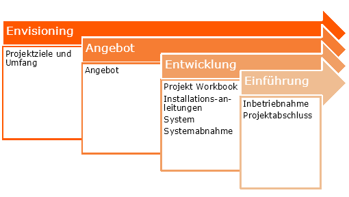

<h3>Projektziele und Umfang</h3>

Redhat Automation in first365 POC

Erstellt für

 first frame networkers ag

| Datum | 26.05.2025 |
| ---- | ---- |
|Version| 1.0 |
|Status| Final |
|Klassifizierung| Vertraulich |
|||

von: Robin Kiefer

**Reviews**

|**Datum**|**Reviewer**|**Position**|**Version bestätigt**|
| :- | :- | :- | :- |
|26.05.2025||PL| Robin Kiefer |

## Inhaltsverzeichnis

- [**1 Projekt Ziele und Umfang**](#1-projekt-ziele-und-umfang)
  - [**1.1 Definition und Zielsetzung**](#11-definition-und-zielsetzung)
  - [**1.2 Vision Statement**](#12-vision-statement)
  - [**1.3 Vorgehensweise**](#13-vorgehensweise)
- [**2 Einleitung**](#2-einleitung)
- [**3 Vision**](#3-vision)
  - [**3.1 POC-Fragestellung:**](#31-poc-fragestellung)
  - [**3.2 POC-Annahmen**](#32-poc-annahmen)
  - [**3.3 Zusammenfassung**](#33-zusammenfassung)
- [**4 Ziele des Kunden**](#4-ziele-des-kunden)
  - [**4.1 Projektidee**](#41-projektidee)
    - [4.1.1 Ausgangslage](#411-ausgangslage)
    - [4.1.2 Lösungsidee](#412-lösungsidee)
  - [**4.2 Lösungsnutzen**](#42-lösungsnutzen)
    - [4.2.1 Business Goals and Objectives](#421-business-goals-and-objectives)
    - [4.2.2 Business Metrics](#422-business-metrics)
    - [4.2.3 Business Assumptions and Constraints](#423-business-assumptions-and-constraints)
    - [4.2.4 Benefits Statement](#424-benefits-statement)
- [**5 Lösungsübersicht**](#5-lösungsübersicht)
  - [**5.1 Ziele, Vorgaben, Annahmen und Randbedingungen**](#51-ziele-vorgaben-annahmen-und-randbedingungen)
    - [5.1.1 Goals](#511-goals)
    - [5.1.2 Objectives](#512-objectives)
    - [5.1.3 Assumptions](#513-assumptions)
    - [5.1.4 Constraints](#514-constraints)
  - [**5.2 Anwenderanalyse**](#52-anwenderanalyse)
    - [5.2.1 Userprofile](#521-userprofile)
    - [5.2.2 Anwendungsfälle](#522-anwendungsfälle)
- [**6 Anforderungen und Abgrenzung**](#6-anforderungen-und-abgrenzung)
  - [**6.1 Businessanforderungen**](#61-businessanforderungen)
  - [**6.2 Anwenderanforderungen**](#62-anwenderanforderungen)
  - [**6.3 Betriebliche Anforderungen**](#63-betriebliche-anforderungen)
  - [**6.4 Technische Anforderungen**](#64-technische-anforderungen)
  - [**6.5 Abgrenzung**](#65-abgrenzung)
- [**7 Projektbeschreibung**](#7-projektbeschreibung)
  - [**7.1 Projektumfang**](#71-projektumfang)
  - [**7.2 Projektvorgehen**](#72-projektvorgehen)
    - [7.2.1 Offert Phase: first frame networkers AG](#721-offert-phase-first-frame-networkers-ag)
    - [7.2.2 Angebot Phase Kunde](#722-angebot-phase-kunde)
    - [7.2.3 Entwicklung \& Einführung](#723-entwicklung--einführung)
    - [7.2.4 Rollen](#724-rollen)
  - [**7.3 Annahmen, Einschränkungen, Abhängigkeiten**](#73-annahmen-einschränkungen-abhängigkeiten)
    - [7.3.1 Annahmen](#731-annahmen)
    - [7.3.2 Einschränkungen](#732-einschränkungen)
    - [7.3.3 Abhängigkeiten](#733-abhängigkeiten)
  - [**7.4 Projektrisiken**](#74-projektrisiken)
    - [7.4.1 Identifizierte Risiken](#741-identifizierte-risiken)
    - [7.4.2 Risikobewertung](#742-risikobewertung)
    - [7.4.3 Massnahmen und Prioritäten](#743-massnahmen-und-prioritäten)
  - [**7.5 Projektumfeldanalyse (PUA)**](#75-projektumfeldanalyse-pua)
    - [7.5.1 Interne Faktoren](#751-interne-faktoren)
      - [Stärken](#stärken)
      - [Schwächen](#schwächen)
    - [7.5.2 Externe Faktoren](#752-externe-faktoren)
      - [Chancen](#chancen)
      - [Risiken](#risiken)
    - [7.5.3 Stakeholder](#753-stakeholder)
      - [Interne Stakeholder](#interne-stakeholder)
      - [Externe Stakeholder](#externe-stakeholder)
    - [7.5.4 Ressourcen](#754-ressourcen)
      - [Technische Ressourcen](#technische-ressourcen)
      - [Menschliche Ressourcen](#menschliche-ressourcen)
  - [**7.6 Änderungsmanagement**](#76-änderungsmanagement)

# **1 Projekt Ziele und Umfang**

## **1.1 Definition und Zielsetzung**

Mit dem Vision and Scope Dokument soll eine gemeinsam abgestimmte und verbindliche Planungsbasis zwischen dem Kunden, first frame networkers ag und gegebenenfalls weiteren beteiligten Partnern geschaffen werden.

Es werden die wesentlichen Erwartungshaltungen, Anforderungen, Ziele und Rahmenbedingungen für das IT-Projekt definiert.

## **1.2 Vision Statement**
Dieses Dokument dient als Zusammenfassung der Ziele des Projektes. Die Absicht dieses Dokumentes ist, die Vision des Einsatzes vom bereits eingereichten Projektantrag zu beschreiben und die Einsatzgebiete zu ermitteln, die nötig sind um diese Vorgabe zu erreichen. Es beschreibt daher den Umfang und die genauen eingesetzten Mittel im Rahmen des Projektes. Veränderungen an Zielen oder Aufgaben können Anpassungen an Projekt-Aktivitäten und Dokumentationen zur Folge haben, was Änderungen an Zeitplan und Projektaufwänden nach sich zieht.

## **1.3 Vorgehensweise**
Dieses Dokument wird in den nachfolgenden Phasen des Projekts als Grundlage für die technische Ausarbeitung, der Konfiguration und Bereitstellung des Systems verwendet werden. Neben diesem vorliegenden Dokument beschreibt das darauffolgende Project Workbook die genaue Umsetzung und Konfiguration des Systems welches im Rahmen des POC umgesetzt wird.

# **2 Einleitung**

Ich besuche zurzeit die HF im Bereich Cloud-Native Engineering.
Infolgedessen konnte ich bereits viel wissen im Bereich Cloud-Init und Linux erarbeiten. Als teil meiner weiterführenden Schule wird nach den Osterferien die erste Semesterarbeit beginnen. Dies hat mich dazu bewegt in unserem Unternehmen nach Chancen zu suchen das gehlernte wissen für unseren Benefit anzuwenden. Nach Rücksprache mit Michael Hediger und Thomas Koller wie auch Marco Schaub habe ich einen Internen Projektantrag für die Vereinfachung und Professionalisierung unserer Redhat Linux Deployments erarbeitet. 

In meiner Ausbildung beschäftigen wir uns Generell mit Cloud Themen. Diese sind auf jeden Fall anwendbar auf unsere eigene Public Cloud first365. Für uns im Rahmen von unseren neuen Unternehmenszielen bin ich der Meinung, dass eine Ausweitung der Automatisierung im Bereich von Deployments ins Thema Empower Customers mit dem Fokus auf Effizienz und Standardisierung entspricht. Dieses Projekt soll nicht eine abschliessende Verbesserung, sondern ein Sprungbrett für Ausbau und Ausweitung der IAC-Methode dienen, mit welcher wir Standardisierung und Effizienz ausbauen und Prozesse vereinfachen können.

# **3 Vision**

Das Ziel dieses Projektes ist in einem POC-Bericht folgende fragen zu beantworten.

## **3.1 POC-Fragestellung:**

1.	Ist IAC zu aufwendig und haben wir zu wenig Deployments um hier einen Vorteil herauszuziehen, verglichen zum Aufwand?
2.	Können wir IAC-Lösungen einfach mit unserer VMware Umgebung integrieren?
3.	Inwiefern wird dies first365 und den Networkers helfen, effizienter zu sein?

## **3.2 POC-Annahmen**

1. Integration in first365 ist leicht umsetzbar und kann durch wenig Aufwand unterhalten werden.
2. Ausbau ist jederzeit granular möglich
3. Ausbaumöglichkeiten betreffen Arbeiten in first365 wie auch mögliche Anwendungen in lokalen Umgebungen bei Kunden.
4.	Aufwand und Kosten sehen IAC zu Gunsten.

## **3.3 Zusammenfassung**

Aus diesen Fragen können wir folgede Projektziele extrahieren.

- Deployment von Redhat Maschinen mit Cloud-Init über Templates auf unseren vCenter zu deployen. 

- Layout einer Git-Struktur für den Ausbau und die Anwendung der Templates.

- Abbildung unserer Referenz konfigurationen via Cloud-Init.

- Klärung der POC-Fragestellungen und Auswertung des Projekts im POC-Bericht.

# **4 Ziele des Kunden**

 **Terminplan des Kunden**
   |**Phase**|**Termin**|
   | :- | :- |
   |Konzeption| 16.06.2025 |
   |Realisierung| 06.07.2025 |
   |Abschluss| 16.07 |

## **4.1 Projektidee**

In diesem Projekt soll, die Viability und den Nutzen der weiteren Automatisiserung unserer Linux Deployments ausgewertet werden. Hier führ wird das Projekt als POC für das Testing und Auswertung dienen um abzuwägen, ob wir eine Umsetzung in das Produktive first365 durchführen wollen.

### 4.1.1 Ausgangslage

In first365 haben wir bereits diverse Redhat Maschinen im Betrieb. Redhat ist die einzige Linux Distribution welche wir als Redhat Partner unterstützen. Die Konfiguration wird Manuell anhand unserer Referenzkonfigurationen im Qwicki durchgeführt. Die Konfigurationskomponenten sind auf verschiedene Systeme und Orte aufgeteilt. 

Bestandteile Konfiguration:
- Referenzkonfigurationen (Qwicki)
- ISOs befinden sich in der Content Library im vCenter
- Erstellung der VM (Manuell in vCenter/vSphere/vCloud)
- Registrierung in Redhat Portal (Manuell via Bash Commands)
- Monitoring in PRTG (Manuell in PRTG Gui konfiguriert)

### 4.1.2 Lösungsidee

Aktuell erfordert das manuelle Deployment von Redhat Linux-Systemen einen beträchtlichen Zeitaufwand, insbesondere durch die individuelle Konfiguration jeder Maschine. Die vorgeschlagene Lösung nutzt IaC, um Deployments zu vereinfachen und zu automatisieren. Durch diesen Ansatz wird:

- Zeit eingespart: Manuelle Setups dauern etwa 60+ Minuten, die Automatisierung reduziert dies auf ca. 15 Minuten.
- Konsistenz gewährleistet: Alle Deployments folgen einer standardisierten Konfiguration.
- Skalierbarkeit verbessert: Die Lösung kann über first365 hinaus erweitert und für andere Umgebungen eingesetzt werden.

**Zielzustand**
- ISOs befinden sich in der Content Library im vCenter
- Erstellung der VM (Automatisiert via Code)
- Registrierung in Redhat Portal (Automatisiert via Code)
- **Optional:** Monitoring in PRTG (Automatisiert via Code)

**Wichtige Aspekte der Umsetzung**
- IaC-Technologie: Nutzung von Terraform oder Ansible, um die Redhat-Deployments zu automatisieren.
- Integration mit VMware: Sicherstellen, dass die erstellten Maschinen nahtlos in die bestehende VMware-Umgebung eingegliedert werden können.
- Sicherheitsanforderungen:
- Kein Deployment-Code soll auf den Zielmaschinen verbleiben.
- Sichergestellter Zugriff auf GitTea für Codeverwaltung.
- Vermeidung von unverschlüsselten Übertragungen von Code oder Passwörtern.
- Erweiterungsmöglichkeiten: Die Lösung kann für verschiedene Kundenumgebungen angepasst und weiter ausgebaut werden.

## **4.2 Lösungsnutzen**

Die Erweiterte Automatisierung bietet diverse Vorteile:  

- **Zeitersparnis**: Deployment-Zeit reduziert sich von 60 Minuten auf 15 Minuten.  
- **Kosteneffizienz**: Weniger manuelle Eingriffe bedeuten geringere Betriebskosten.  
- **Standardisierung**: Einheitliche und skalierbare Setups für first365 und potenzielle Kundenumgebungen.  
- **Sicherheit**: Keine Speicherung von Deployment-Code auf Maschinen, verschlüsselte Übertragungen.

### 4.2.1 Business Goals and Objectives
- **Erhöhung der Automatisierung** innerhalb der first365.  
- **Standardisierte Deployments** mit hoher Wiederholbarkeit.  
- **Minimierung manueller Eingriffe**, um Effizienz zu steigern.  
- **Verbesserung der Integration** in bestehende VMware-Umgebungen.  
- **Skalierbarkeit sichern**, um langfristig weitere Automatisierungsprozesse zu implementieren.  

### 4.2.2 Business Metrics
- **Deployment-Zeit pro Maschine** vorher: 60 min → nachher: 15 min.  
- **Kosten pro Deployment** vorher: ~92.5–97.5 CHF → nachher: ~23.2 CHF.  
- **Anzahl automatisierter Tasks** (Monitoring, User-Erstellung, Registrierungen).  
- **Reduzierung operativer Fehler** durch Standardisierung der Prozesse.  

### 4.2.3 Business Assumptions and Constraints  
- **Technische Annahmen**:  
  - Integration in first365 ist machbar und mit geringem Wartungsaufwand umsetzbar.  
  - Skalierbarkeit ist flexibel, Erweiterungen sind jederzeit möglich.  
- **Kostenbezogene Einschränkungen**:  
  - Budget für das Projekt ist auf 50h interne Arbeitszeit limitiert.  
- **Technische Herausforderungen**:  
  - Sicherstellung der Kompatibilität mit VMware.  
  - Sicherheitsanforderungen ohne Kompromisse bei Effizienz umsetzen.

### 4.2.4 Benefits Statement
Die Implementierung von IaC für Redhat Linux Deployments wird langfristig zu einer effizienteren, standardisierten und kostengünstigen Infrastruktur führen. Dadurch verbessert sich nicht nur die interne Prozessqualität, sondern auch die Möglichkeit, first frame Kunden mit optimierten Deployment-Methoden zu unterstützen. Zusätzlich wird der IT-Betrieb durch Automatisierung entlastet, wodurch strategische Aufgaben stärker in den Fokus rücken können.

# **5 Lösungsübersicht**

## **5.1 Ziele, Vorgaben, Annahmen und Randbedingungen**

### 5.1.1 Goals
Der **Proof of Concept (POC)** soll die Machbarkeit und den potenziellen Nutzen der Automatisierung von Redhat Linux Deployments mit Infrastructure as Code (IaC) in first365 evaluieren. Dabei sollen Skalierbarkeit, Effizienzsteigerung und Standardisierung getestet werden.

### 5.1.2 Objectives
1. **Technische Machbarkeit prüfen**:  
   - Kann IaC erfolgreich in first365 integriert werden?  
   - Wie gut funktioniert die Anbindung an VMware?  
2. **Effizienzsteigerung nachweisen**:  
   - Vergleich der aktuellen Deployment-Zeit (~60 Minuten) mit der automatisierten Lösung (~15 Minuten).  
   - Reduzierung operativer Fehler durch Standardisierung.  
3. **Sicherheitsanforderungen testen**:  
   - Kein Deployment-Code verbleibt auf Zielmaschinen.  
   - Sicherstellung von verschlüsselten Übertragungen und Zugriffskontrollen.  
4. **Potenzielle Skalierungsmöglichkeiten aufzeigen**:  
   - Kann der Ansatz auf Kundenumgebungen ausgeweitet werden?  
   - Identifizierung von Erweiterungspotenzial für weitere Automatisierungsprozesse.  

### 5.1.3 Assumptions
- **IaC ist kompatibel mit first365 und VMware** ohne grössere Anpassungen.  
- **Aufwand zur Implementierung bleibt im Rahmen der verfügbaren Ressourcen (50h Arbeitszeit).**  
- **Skalierbarkeit ist einfach umsetzbar**, sodass der Ansatz auf weitere Systeme angewendet werden kann.  
- **Kosten/Nutzen-Verhältnis ist positiv**, sodass der POC eine spätere Implementierung rechtfertigt.  

### 5.1.4 Constraints
- **Begrenzte interne Ressourcen** (50h Arbeitsaufwand, keine externen Kosten).  
    
- **Sicherheitsvorgaben**:  
  - Keine Speicherung von Deployment-Code auf Maschinen.  
  - Sichergestellte Zugriffskontrolle auf Konfigurationsdateien.  

## **5.2 Anwenderanalyse**
   Die Anwender sind die Engineers der firstframe.
   Die Anwender Analyse läst sich in einem Userprofile

### 5.2.1 Userprofile

   | Userprofile | Name | Beschreibung |
   |--|--|--|
   | UP01 | Datacenter Team | Erstellt und Konfiguriert VMs, Richtiet das Monitoring ein , Entwickelt Lösungen, Macht Unterhalt und Betrieb von first365 |
   | UP02 | Engineering | Erstellt und Konfiguriert VMs |
   ||||
   
### 5.2.2 Anwendungsfälle

| Userprofile | Beschreibung |
|--|--|
| UP01 | Einloggen via VS-Code auf das Repository, Parameter für Deployment mitgeben und VM-Erstellen lassen |
| UP02 | Einloggen via VS-Code auf das Repository, Parameter für Deployment mitgeben und VM-Erstellen lassen |

# **6 Anforderungen und Abgrenzung**

## **6.1 Businessanforderungen**
Die nachfolgende Tabelle definiert die wichtigsten Anforderungen an das Design und die Deployment Strategie der Lösung aus Sicht des Business:

| Nr.  | Anforderung                       | Beschreibung                                                                 |
|------|-----------------------------------|-------------------------------------------------------------------------------|
| B01  | Automatisierung der VM-Erstellung | Die Erstellung von VMs soll automatisiert werden, um Zeit zu sparen und Konsistenz zu gewährleisten. |
| B02  | Standardisierung der Konfiguration | Alle Deployments sollen einer standardisierten Konfiguration folgen, um Fehler zu minimieren und die Wartung zu erleichtern. |
| B03  | Integration mit VMware            | Die automatisierten Deployments müssen nahtlos in die bestehende VMware-Umgebung integriert werden. |

## **6.2 Anwenderanforderungen**

| Nr.  | Anforderung          | Beschreibung                                                                 |
|------|----------------------|-------------------------------------------------------------------------------|
| U01  | Benutzerfreundlichkeit | Die Lösung muss einfach zu bedienen sein, damit das Datacenter Team und das Engineering-Team sie problemlos nutzen können. |
| U02  | Dokumentation        | Eine umfassende Dokumentation der automatisierten Prozesse und Konfigurationen muss bereitgestellt werden. |

## **6.3 Betriebliche Anforderungen**
| Nr.  | Anforderung          | Beschreibung                                                                 |
|------|----------------------|-------------------------------------------------------------------------------|
| O01  | Effizienzsteigerung  | Die Automatisierung soll die Effizienz steigern und die Zeit für manuelle Setups von 60 Minuten auf 15 Minuten reduzieren. |
| O02  | Skalierbarkeit       | Die Lösung muss skalierbar sein, um zukünftige Erweiterungen und Anpassungen zu ermöglichen. |

## **6.4 Technische Anforderungen**

| Nr.  | Anforderung          | Beschreibung                                                                 |
|------|----------------------|-------------------------------------------------------------------------------|
| T01  | Sicherheit           | Es darf kein Deployment-Code auf den Zielmaschinen verbleiben, und alle Übertragungen müssen verschlüsselt sein. |
| T02  | Zugriffskontrolle    | Der Zugriff auf Konfigurationsdateien muss gesichert und kontrolliert werden. |
| T03  | Kompatibilität       | Die Lösung muss mit first365 und VMware kompatibel sein, ohne grössere Anpassungen zu erfordern. |

## **6.5 Abgrenzung**

- Die Automatisierung vom Monitoring ist ein Optionales Ziel
- Es wird keine GO-Live geben, da es sich um ein POC handelt
- Es werden keine Referenzkonfiguration erstellt nur verwendet um diese abzubilden
- Es wird keine anleitung für die Verwendung ausser das Projectworkbook geben

# **7 Projektbeschreibung**
In diesem Abschnitt wird das Projekt, Vorgehen und den Umfang beschrieben. Dies beeinhaltet auch die Zuständigkeiten und Anlaufstellen.

## **7.1 Projektumfang**
| Inhalt | Beschreibung | Format |
|--|--|--|
| Projekt Ziele und Umfang | Hier werden die Ziele des Projekts die Abgrenzungen und das Risiko definiert und Dokumentiert | PDF |
| Projectworkbook | Hier wird die Technische Umsetzung genau geplant und Dokumentiert. Dies Dient auch als Vorlage für die Produktive Umsetzung | PDF |
| POC-Bericht | Hier werden die Fragen des POCs beantwortet und das Projekt gemessen an den Definierten Zielen | PDF |
| QS | Der Qualitäts-Check wird die Qualität des Lieferumgfangs von einer Unanbhängigen Preson überprüft | PDF |
| Test-Protokoll | Im Testprotokoll werden die Ergebnisse der Tests festgehalten | PDF |
| GitLab-Repository | Hier sind alle Codes und Dokumentationen abgelegt. | ZIP-Folder |

## **7.2 Projektvorgehen**
Als langjähriger Dienstleister setzt first frame eine praxiserprobte Vorgehensmethode ein. Es handelt sich dabei um ein inkrementelles, iteratives Prozessmodell zur Erreichung einer optimalen Projektqualität
Ein Release wird in folgende vier überlappende Tracks unterteilt, die jeweils eine Gruppe von Aktivitäten umfassen
   

   
Das gesamte Projekt wird in mehrere Phasen aufgeteilt, die zugleich als Milestones zu sehen sind. Der zeitliche Ablauf wird in einem Microsoft Projekt basierenden File geplant und transparent gemacht.

### 7.2.1 Offert Phase: first frame networkers AG
Dieses Kapitel listet die Verantwortungen der first frame networkers in der Planning Phase auf

|**Aufgabe**|**Zuständigkeit**|
| :- | :- |
|Zuweisung eines Consultant für die Planung der Architektur|ffn|
|Erstellen und Führen des Vision and Scope Dokumentes|ffn|
|Erstellen und Beschreiben der Architektur im Planning Workbook Dokument|ffn|
|Überprüfung und Freigabe der Architektur|ffn|
|Erstellen und Führen des Projekt Plans|ffn

### 7.2.2 Angebot Phase Kunde
Dieses Kapitel listet die Verantwortungen des Kunden in der Planning Phase auf
|**Aufgabe**|**Zuständigkeit**|
| :- | :- |
| Review Projekt Ziele und Umfang |Kunde
      
### 7.2.3 Entwicklung & Einführung
Dieses Kapitel listet die wichtigsten Arbeiten während des Projektes auf und welche involvierte Partei zuständig ist
      
|**Aufgabe**|**Zuständigkeit**|
| :- | :- |
| Entwicklung, Planung, Umsetzung, Lieferung | ffn |

### 7.2.4 Rollen
Das Projekt Team der first frame gliedert sich in nachfolgende Rollen. 

- Project Manager
  - **Robin Kiefer** Review und Freigabe des Projekt Dokuments 
  - **Robin Kiefer / FFN** Unterstützung und Tracking der Projektplanung
  - **Robin Kiefer** Anlaufstelle für Eskalation wenn Probleme auftreten oder Koordination gefragt ist.
  -  **Robin Kiefer** Übersicht / Leitung des Projektes bis zur Abnahme

- System Engineer
  -  **Robin Kiefer** Technischer Kontakt im Rahmen des Projektes
  - **Robin Kiefer** Durchführung des Workshops mit der anschliessenden Erstellung des Vision Scope Dokuments
  - **Robin Kiefer** Erstellung des Planning Workbooks mit der Detail Konfiguration
  - **Robin Kiefer** Aufbau und Konfiguration des Systems
  - **Robin Kiefer** Admin Schulung / Einweisung
  
## **7.3 Annahmen, Einschränkungen, Abhängigkeiten**
### 7.3.1 Annahmen
Annahmen werden von der frist frame getroffen, wenn eine Ausgangslage unklar oder nicht beschrieben ist. Die Annahmen müssen vom Kunden verifiziert werden. Sollten Annahmen nicht korrekt sein, so sind diese zu besprechen und anzupassen.

|**Annahme**|**Beschreibung** |
| :- | :- |
|Netzwerk Kapazität|Annahme, dass die Netzwerk Kapazität und Verfügbarkeit gut ist|
|Netzwerk Konfiguration|Annahme, dass die Netzwerk Dienste (DNS, ADDS) fehlerlos zur Verfügung stehen|
|Active Directory|Annahme, dass zum Start der Installation der Active Directory Domain Service (ADDS) gut gewartet ist und fehlerfrei funktioniert|
|Compliance|Annahme, dass die Umgebung des Kunden in einem gepatchten, malwarefreien Zustand ist|
|VM Infrastruktur|Die bereitgestellten virtuellen Maschine sowie deren VM Plattform ist funktionsfähig und performant|

### 7.3.2 Einschränkungen
Derzeit keine bekannt.

### 7.3.3 Abhängigkeiten
Nachfolgende Tabelle zeigt die wichtigsten Abhängigkeiten bei der Umsetzung des Projektes:

|**Abhängigkeit**|**Beschreibung** |
| :- | :- |
|Hardware / VM’s|Der Kunde wird die Hardware/VM’s zur Verfügung stellen|
|Permissions|Der Kunde muss einen Account mit Enterprise Admin Rechten zur Verfügung stellen|
|Administrator Schulung|Es liegt in der Verantwortung des Kunden, sicherzustellen, dass ausreichend administratives Knowhow aufgebaut wird, um die Lösung nach dem Projekt selber zu betreiben|
|||

## **7.4 Projektrisiken**

### 7.4.1 Identifizierte Risiken

1. **Fehlfunktion von Cloud-Init Templates**

   * **Beschreibung**: Fehlerhafte Konfiguration kann zu unvollständigen oder instabilen VMs führen.
   * **Auswirkung**: Verzögerungen, Nachbearbeitungsaufwand.
   * **Massnahmen**: Validierungstools nutzen, Unit Tests für Templates einbauen.

2. **GIT-Zugriffsprobleme / Secrets-Leaks**

   * **Beschreibung**: Fehlkonfiguration im Repository kann zu versehentlicher Veröffentlichung von Zugangsdaten führen.
   * **Auswirkung**: Sicherheitsvorfall, Systemkompromittierung.
   * **Massnahmen**: Git-Policies setzen, Secrets Management.

3. **POC zeigt keinen messbaren Mehrwert**

   * **Beschreibung**: Aufwand/Nutzen-Verhältnis fällt negativ aus.
   * **Auswirkung**: Keine Produktivumsetzung, Projektziele verfehlt.
   * **Massnahmen**: Klare KPIs definieren (Zeit, Kosten, Fehler), Ist-Vergleich vorab erfassen.

4. **Tool-Inkompatibilität mit vSphere/vCenter**

   * **Beschreibung**: Codes sind nicht kompatibel mit der eingesetzten vCenter-Version.
   * **Auswirkung**: Stopp des POC, zusätzlicher Aufwand.
   * **Massnahmen**: Kompatibilität vorab prüfen, Test mit isolierter VM-Umgebung.

---

### 7.4.2 Risikobewertung

| Risiko                         | Wahrscheinlichkeit (1–5) | Auswirkung (1–5) | Punkte |
| ------------------------------ | ------------------------ | ---------------- | ------ |
| Cloud-Init Fehlkonfiguration   | 4                        | 3                | 12     |
| GIT-Zugriffs-/Secrets-Probleme | 3                        | 5                | 15     |
| Kein messbarer Nutzen im POC   | 2                        | 5                | 10     |
| Tool-Inkompatibilität          | 3                        | 4                | 12     |

---

### 7.4.3 Massnahmen und Prioritäten

1. **GIT-Zugriffs-/Secrets-Probleme** (Punkte: 15)

   * **Massnahmen**: Zugriffskontrollen, interne Repos.
   * **Priorität**: **Hoch**

2. **Cloud-Init Fehlkonfiguration** (Punkte: 12)

   * **Massnahmen**: Pre-Test Umgebung, automatisierte Validierung.
   * **Priorität**: **Mittel**

3. **Tool-Inkompatibilität** (Punkte: 12)

   * **Massnahmen**: Lab-Umgebung bereitstellen, Versionsabgleich.
   * **Priorität**: **Mittel**

4. **Kein messbarer Nutzen im POC** (Punkte: 10)

   * **Massnahmen**: POC-Kriterien frühzeitig festlegen, Zeit-/Kostenvergleich dokumentieren.
   * **Priorität**: **Mittel**

---

## **7.5 Projektumfeldanalyse (PUA)**

### 7.5.1 Interne Faktoren

#### Stärken

* **Automatisierte VM-Erstellung**: Zeiteinsparung von >70 %.
* **Standardisierung**: Reduziert Variabilität und vereinfacht Audits.
* **Kompatibilität mit bestehender VMware-Umgebung**: Nahtlose Integration.
* **Git-basierte Verwaltung**: Versionskontrolle, Nachvollziehbarkeit.
* **Klares Rollenkonzept**: Eigenständigkeit für Engineering-Team.

#### Schwächen

* **IaC Know-how ist begrenzt**: Schulung erforderlich.
* **Pflegebedarf für Templates und Doku**: Zeitintensiv.
* **Erfahrung mit Cloud-Init intern begrenzt**: Gefahr von Fehlkonfigurationen.

---

### 7.5.2 Externe Faktoren

#### Chancen

* **Produktivumsetzung möglich**: POC als Sprungbrett für generelle Automatisierung.
* **Kundenlösungen vereinheitlichen**: Einsatz auch bei Hybridkunden möglich.
* **Reputationsgewinn**: first365 als modern automatisierte Plattform.

#### Risiken

* **VMware API ändert sich mit Updates**: Gefahr von Funktionsausfällen.
* **Sicherheitsanforderungen steigen**: Audits könnten automatisierte Deployments kritischer prüfen.
* **Abhängigkeit von Git-Plattform intern**: Ausfall = Stillstand.

---

### 7.5.3 Stakeholder

#### Interne Stakeholder

* **Datacenter Team**: Implementierung, Betrieb, Troubleshooting.
* **Engineering-Team**: Nutzung, Rückmeldungen, Weiterentwicklung.

#### Externe Stakeholder

* **first365 Produktverantwortliche**: Interesse an erweiterbarer Lösung.
* **IT Security Verantwortliche**: Anforderungen an Geheimhaltung & Zugriff.
* **VMware Ansprechpartner**: Technischer Support bei vCenter-Anbindung.

---

### 7.5.4 Ressourcen

#### Technische Ressourcen

* vCenter Umgebung / vSphere API
* GitTea Repository
* Cloud-Init unterstütztes Redhat Template

#### Menschliche Ressourcen

* Projektleitung (Robin Kiefer)
* Technisches Know-how aus Engineering-Team
* Qualitätssicherung intern (Review & Testing)

## **7.6 Änderungsmanagement**
Jede Änderung der Anforderungen benötigt eine Anpassung der Projektdokumente und erfordert eine Übereinkunft von Projektmanagement seitens first frame und Kunde.

